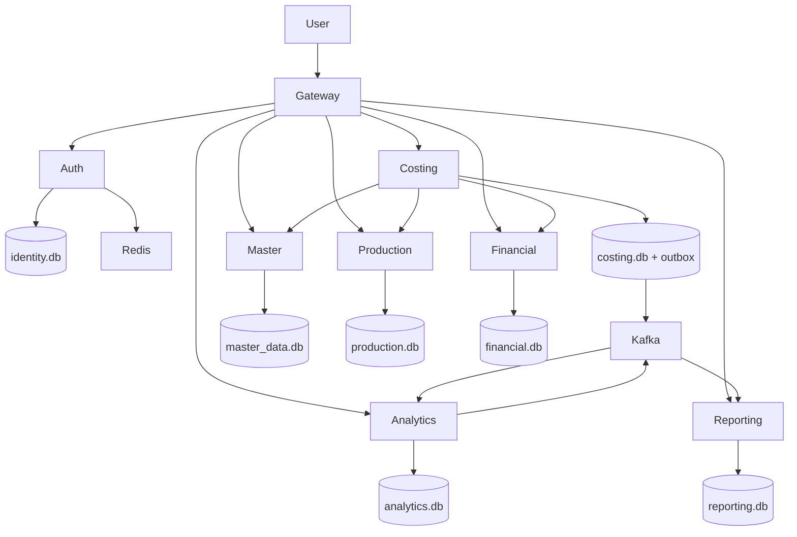

# Архитектура итоговой системы

GraphQL Gateway — внешний прикладной контракт с пользовательскими JWT, активными Redis-сессиями и RBAC. Auth работает с Identity. Внутренние RPC требуют отдельный короткоживущий service JWT и проверку роли; порты 50051–50056 не публикуются.

| Владелец | Собственные данные |
|---|---|
| Identity | Пользователи, роли, назначения |
| Master Data | Продукция, группы, материалы, нормы, центры затрат, EXTERNAL_MAPPING и PLANNED_COST |
| Production Integration | Заказы, материалы, труд, локальные IMPORT_RUN/IMPORT_ERROR и outbox |
| Financial Integration | Реализация, исходные FINANCIAL_ENTRY OVERHEAD/CORRECTION, локальные IMPORT_RUN/IMPORT_ERROR и outbox |
| Costing | Калькуляции, source_versions, плановый снимок, OVERHEAD_ALLOCATION, готовность источников и outbox |
| Analytics | Версионированные результаты рентабельности и CalculationJob |
| Reporting | Текущая read model, SavedReport и файлы экспортов |

Master Data — источник истины утверждённой плановой себестоимости; Costing сохраняет её версию и значение. Накладные факты Financial не заменяются результатами распределения Costing. Два журнала импорта физически независимы, каждый со своим владельцем.

Межсервисные связи выполняются через gRPC без прямого SQL к чужой базе. Импорт разрешает внешние коды через LookupExternalMapping. Production передаёт базу распределения до уровня заказа и центра затрат, Financial — нетто-суммы по центрам. Costing сохраняет распределения и событие одной транзакцией с outbox.

profitability и profitabilitySummary читают только Reporting projection, обновляемую Kafka. Это eventual consistency. Пустой набор продуктов не означает отсутствие фильтра. costCenterIds отбирает продукцию по участию центра в калькуляции; overheadAllocations раскрывает реальные распределённые суммы.

COMPLETED калькуляции и задания при изменении источников становятся INVALIDATED. Для MasterDataChanged используется консервативная инвалидация всех зависимых расчётов и кеша нормативов. Подробнее: integration.md, resilience.md и review-fixes.md.
